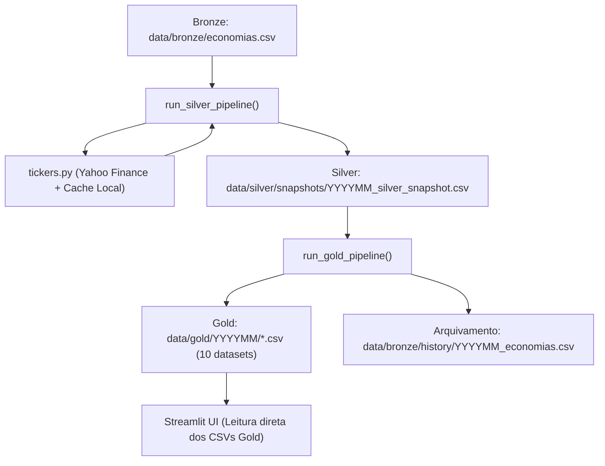

# AGENT_CONSTITUTION.md

> Documento mandatório de governança, diretrizes de arquitetura e regras de implementação para agentes de IA atuando no repositório **Investment Visualizer**.

---

## 1. Convenção Fundamental de Governança

### 1.1 Regra de Ouro do Repositório
Toda e qualquer IA que atuar neste repositório DEVE, obrigatoriamente, ao alterar código, pipeline, regras de negócio, transformações das camadas (Bronze, Silver, Gold), lógica de métricas financeiras ou componentes do dashboard:
1. **Verificar a integridade deste documento (`AGENT_CONSTITUTION.md`)** e atualizá-lo para que ele continue refletindo com 100% de exatidão o estado operacional e técnico do projeto.
2. **Manter o isolamento de dados privados:** Nunca inserir dados patrimoniais reais, valores confidenciais, notas particulares ou nomes de arquivos de rascunho local neste documento. Use sempre exemplos sintéticos e schemas canônicos baseados em `data/bronze/dummy.csv`.

### 1.2 Convenção de Implementação de Funções
Para toda função criada, refatorada ou estendida no repositório:
* **Docstring Obrigatória:** Descrever com clareza a responsabilidade, regras de negócio/fórmulas aplicadas, parâmetros de entrada e estrutura de retorno.
* **Retorno por Variável Intermediária:** O resultado da função deve sempre ser atribuído a uma variável nomeada antes da instrução de retorno (ex: `df_result = ...` seguido de `return df_result`), facilitando leitura, depuração e inspeção em runtime.

---

## 2. Visão Geral e Stack Tecnológica

O **Investment Visualizer** é um sistema em Python para consolidação, enriquecimento e acompanhamento de carteiras de investimentos a partir de arquivos de posições periódicas.

### Stack Tecnológica
* **Python**: Versão `>=3.11,<3.12`.
* **Apache Spark / PySpark**: Processamento distribuído local (`local[1]`, driver memory conservador de 4GB). Empregado para garantir robustez analítica, paralelismo controlado e estudo de arquiteturas de dados corporativas em escala pessoal.
* **Pandas**: Gestão do cache local de cotações e conversões intermediárias pontuais.
* **yfinance**: Coleta de preços de fechamento históricos da B3.
* **Streamlit**: Interface web analítica multipage com roteamento via `st.navigation`.
* **Plotly**: Visualizações interativas (gráficos de linha temporal, barras agrupadas e pizza).

---

## 3. Estrutura Canônica de Diretórios

```text
investment-visualizer/
├── AGENT_CONSTITUTION.md         # [ESTE ARQUIVO] Leis de governança e arquitetura para IA
├── README.MD                     # Documentação de apresentação e manual de inicialização
├── pyproject.toml                # Metadados do projeto, dependências e comandos CLI
├── app/                          # Aplicação Streamlit (Interface de Usuário)
│   ├── streamlit_app.py          # Entrypoint da UI, roteador global e seletor de competência
│   ├── commands.py               # Funções de inicialização via CLI (iv-run, iv-app)
│   ├── components/
│   │   ├── charts.py             # Componentes de gráficos Plotly (linha, barras, pizza)
│   │   └── commons.py            # Componentes visuais compartilhados, cards e estilos
│   ├── config/
│   │   └── pages.py              # Catálogo de páginas e escopos institucionais
│   ├── pages/
│   │   ├── home.py               # Visão consolidada geral da carteira
│   │   ├── aportes.py            # Matriz anual e histórico consolidado de aportes
│   │   ├── page_1.py             # Visão específica da instituição 1
│   │   ├── page_2.py             # Visão específica da instituição 2
│   │   ├── page_3.py             # Visão específica da instituição 3
│   │   └── page_4.py             # Visão específica da instituição 4
│   └── static/                   # Tipografia (SpaceGrotesk e SpaceMono)
├── data/                         # Camadas de dados locais (ignoradas no controle de versão)
│   ├── bronze/
│   │   ├── economias.csv         # Entrada de dados brutos a processar
│   │   ├── dummy.csv             # Conjunto de dados sintéticos mantido no Git como referência
│   │   └── history/              # Histórico de entradas brutas arquivadas pós-execução
│   ├── silver/
│   │   ├── snapshots/            # Snapshots particionados limpos e tipados
│   │   └── tickers_cache/        # Cache persistente de cotações (Parquet e CSV)
│   └── gold/
│       └── YYYYMM/               # Partições mensais com os 10 datasets prontos para a UI
├── infra/
│   └── spark_utils.py            # Sessão PySpark e normalização numérica pt-BR
└── pipelines/                    # Engenharia de Pipelines ETL
    ├── run_pipeline.py           # Orquestrador mestre (Bronze → Silver → Gold → Arquivamento)
    ├── shared/
    │   ├── logging_utils.py      # Padronização de logs e coletor de avisos da execução
    │   └── partition_handler.py  # Gestão de partição e gravação por camada
    ├── silver/
    │   ├── transformations.py    # Pipeline Silver: explosão, tipagem, normalização e validação
    │   └── tickers.py            # Integração com Yahoo Finance e gestão de cache
    └── gold/
        └── gold_metrics.py       # Pipeline Gold: rentabilidade real, foto full e agregações
```

---

## 4. Comandos de Linha de Comando (CLI)

Registrados no `pyproject.toml` e implementados em `app/commands.py`:

| Comando | Função Python | Comportamento |
| :--- | :--- | :--- |
| `iv-run` | `iv_run()` | Executa o pipeline ETL completo e, em seguida, abre o Streamlit |
| `iv-app` | `iv_app()` | Inicia exclusivamente o servidor do dashboard Streamlit |
| `python -m pipelines.run_pipeline` | `run_pipeline()` | Executa apenas o pipeline de dados de ponta a ponta |

---

## 5. Pipeline ETL (Medallion Architecture)



### 5.1 Camada Bronze (Dados Brutos)
* **Arquivo esperado:** `data/bronze/economias.csv` (contendo os lançamentos históricos até a data de corte).
* **Contrato de colunas:** `timestamp`, `data_apuracao`, `instituicao_fin`, `resumo`, `aporte`.
* **Formato do campo `resumo`** (multilinha, delimitado por pipe `|`):
  ```text
  tipo | nome | qtd | preco_medio | preco_atual
  ```
  - `tipo = "stock"`: O `preco_atual` pode vir em branco para busca automática de cotação.
  - Demais classes (renda fixa, fundos, cripto): O `preco_atual` deve vir informado no registro.
* **Arquivamento:** Concluída a pipeline com sucesso, o arquivo de entrada é movido para `data/bronze/history/{YYYYMM}_economias.csv`.

### 5.2 Camada Silver (`pipelines/silver/transformations.py`)
1. **Explosão do Resumo:** A célula multilinha de cada instituição é desdobrada em linhas unitárias de investimento.
2. **Validação Estrita:** Cada linha gerada precisa conter rigorosamente os 5 campos esperados. Linhas vazias são descartadas; linhas com ausência de campos mandatórios abortam a execução com `ValueError`.
3. **Normalização pt-BR:** Conversão padronizada de números com vírgula e ponto para formato decimal numérico (`1.234,56` $\rightarrow$ `1234.56`).
4. **Enriquecimento Temporal:** Derivação de `ano`, `mes_num` e `mes` textual.
5. **Regras de Negócio de Tipagem:**
   - Fundos imobiliários são normalizados para `tipo = "stock"`.
   - Criptoativos e tickers listados em `INTERNATIONAL_TICKERS` recebem `exposicao = "internacional"`; demais recebem `"nacional"`.
6. **Cotações e Cache (`pipelines/silver/tickers.py`):**
   - Tickers de ações sem preço informado são consultados no Yahoo Finance via `yfinance` com sufixo `.SA` e lookback de 7 dias.
   - O cache persistente (`data/silver/tickers_cache/`) é atualizado deduplicando por `(ticker, data_preco)`.
   - Aplica-se primeiro o join exato por data de apuração e, como contingência, fallback para o preço mais recente válido.
7. **Validação Final:** Se qualquer posição permanecer com `preco_atual` ou `valor_total` nulo, a pipeline é imediatamente abortada.

---

## 6. Camada Gold e Modelagem Financeira (`pipelines/gold/gold_metrics.py`)

A camada Gold processa o snapshot Silver gerado e entrega **10 datasets** modelados para consumo imediato pela interface do usuário.

### 6.1 Regra da Foto Full da Carteira Atual
* **Problema Resolvido:** Quando um ativo deixa de ser informado em um mês recente (venda total ou remoção da carteira), ele não pode ser trazido de meses passados ("ativo fantasma").
* **Implementação Técnica:** A identificação dos ativos atuais (`df_dados_atuais` e `df_val_atual_page`) utiliza janela particionada estritamente por instituição, ordenando por data decrescente:
  ```python
  latest_inst_window = Window.partitionBy("instituicao_fin").orderBy(F.col("data_apuracao").desc())
  df_dados_atuais = (
      df_silver
      .withColumn("_rank", F.dense_rank().over(latest_inst_window))
      .filter(F.col("_rank") == 1)
      .drop("_rank")
  )
  ```
* **Efeito:** Apenas os ativos que figuram expressamente no último registro de cada instituição compõem a tabela de posições e os gráficos de pizza.

### 6.2 Rentabilidade Real Descontando Aportes — Opção A
* **Problema Resolvido:** O dinheiro novo aportado na carteira não pode ser interpretado como valorização ou lucro de investimentos.
* **Fórmula Adotada (Opção A — Aporte no Final do Mês):**
  $$\text{Rentabilidade (\%)} = \frac{\text{Valor Atual} - \text{Valor Anterior} - \text{Aporte}}{\text{Valor Anterior}} \times 100$$
* **Implementação:** Função `get_variation_with_flow` em `gold_metrics.py`.
* **Escopos Aplicados:**
  - Consolidado Geral da Carteira (`ALL` na Home).
  - Totais de cada instituição financeira (`home_botoes` e linha `ALL` das instituições).

### 6.3 Variação Mensal de Ativos Individuais nos Gráficos
* **Problema Resolvido:** A aquisição de novas cotas de um mesmo ativo entre meses (ex: passar de 10 para 30 cotas) inflava o patrimônio daquela linha, gerando falsos picos percentuais (ex: +200%) no gráfico de evolução do ativo.
* **Regra Adotada:** Nos gráficos de evolução temporal mensal por ativo individual (`nome != 'ALL'` em `instituicao_linha`), a variação mede exclusivamente a oscilação da **cota/preço unitário**:
  $$\text{Variação do Ativo (\%)} = \frac{\text{preço\_atual}_t - \text{preço\_atual}_{t-1}}{\text{preço\_atual}_{t-1}} \times 100$$

### 6.4 Tabela Detalhada de Investimentos (`instituicao_label`)
* **Regra de Exibição:** Na tabela detalhada de cada instituição, a coluna `Var. %` representa o **retorno acumulado da posição desde a aquisição em relação ao preço médio**:
  $$\text{Retorno da Posição (\%)} = \frac{\text{valor\_total} - \text{preço\_entrada}}{\text{preço\_entrada}} \times 100 = \frac{\text{preço\_atual} - \text{preço\_médio}}{\text{preço\_médio}} \times 100$$
  onde $\text{preço\_entrada} = \text{qtd} \times \text{preço\_médio}$.

### 6.5 Catálogo dos 10 Datasets Gold

Gerados na pasta `data/gold/{YYYYMM}/` no formato `{YYYYMM}_gold_{nome}_snapshot.csv`:

| # | Identificador | Escopo Temporal e Agrupamento | Consumo no Dashboard |
|---|---|---|---|
| 1 | `home_linha` | Mensal: consolidado `ALL` e por instituição | Gráfico temporal da Home (valores absolutos e rentabilidade Opção A) |
| 2 | `home_botoes` | Último mês: `ALL` e por instituição | Botões de atalho da Home com valor total e rentabilidade recente |
| 3 | `home_barras` | Anual: `ALL` e por instituição | Gráfico anual consolidado deduzindo aportes anuais |
| 4 | `aportes_linha` | Mensal: `ALL` e por instituição | Gráfico temporal de evolução dos aportes realizados |
| 5 | `aportes_barras` | Anual: `ALL` e por instituição | Gráfico anual de barras de aportes |
| 6 | `pizza_expo` | Última foto: Nacional vs Internacional | Gráficos de distribuição por exposição geográfica |
| 7 | `pizza_tipo` | Última foto: Stock, Cripto, Renda Fixa | Gráficos de distribuição por classe de ativo |
| 8 | `instituicao_linha` | Mensal: por ativo individual e `ALL` | Gráfico de evolução na tela da instituição (oscilação de cota e rentabilidade total) |
| 9 | `instituicao_label` | Última foto: detalhamento por ativo | Tabela de investimentos da instituição com preço médio, cota e retorno acumulado |
| 10 | `instituicao_barras` | Anual: por ativo individual e `ALL` | Gráficos anuais de barras na tela da instituição |

---

## 7. Diretrizes de Privacidade e Dados Locais

1. **Separação Rígida entre Código e Dados Pessoais:**  
   O repositório é concebido para ser compartilhado publicamente como demonstração de engenharia de dados e governança de agentes.
2. **Política de `.gitignore`:**  
   Todas as saídas analíticas geradas, históricos e entradas contendo registros reais de patrimônio em `data/**` (exceto o arquivo sintético de teste `data/bronze/dummy.csv`) permanecem estritamente ignoradas no controle de versão.
3. **Massa de Teste Canônica:**  
   Qualquer teste funcional ou demonstração automatizada deve se basear na massa mockada `data/bronze/dummy.csv`, executável com:
   ```powershell
   python -c "from pipelines.run_pipeline import run_pipeline; run_pipeline('data/bronze/dummy.csv')"
   ```
