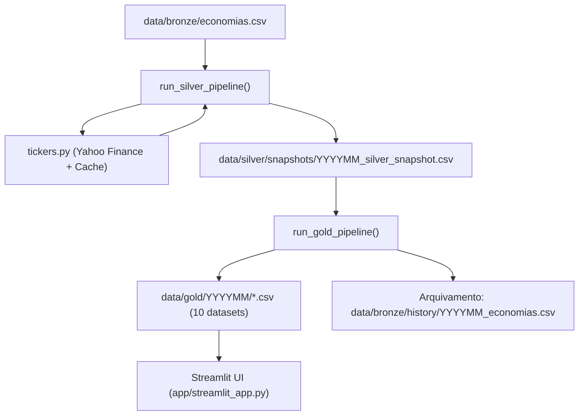

# AI_INSTRUCTIONS.md — Diretrizes de Arquitetura e Regras para a IA

> **ARQUIVO OBRIGATÓRIO DE DIRECIONAMENTO PARA ASSISTENTES DE IA**  
> Fonte única da verdade sobre o funcionamento técnico, arquitetura de dados e regras de negócio do repositório **Investment Visualizer**.

---

## ⚠️ CONVENÇÃO OBRIGATÓRIA DO REPOSITÓRIO

> [!IMPORTANT]
> **REGRA DE OURO PARA QUALQUER IA QUE ATUAR NESTE REPOSITÓRIO:**  
> Sempre que qualquer alteração de código, regra de negócio, transformação de dados (Bronze, Silver, Gold), fórmula de métrica ou componente de interface for modificado, adicionado ou refatorado, a IA DEVE **obrigatoriamente verificar se este documento (`AI_INSTRUCTIONS.md`) precisa de atualização** e atualizá-lo para que ele continue refletindo 100% da realidade do projeto.
>
> **CONVENÇÃO DE ESTILO DE FUNÇÃO:**  
> Para qualquer função criada ou ajustada no repositório:
> 1. Escreva uma **docstring completa e detalhada** (descrição, regras de negócio/fórmulas, parâmetros e retorno).
> 2. Atribua o resultado a uma **variável intermediária antes do retorno** (ex: `df_result = ...` e depois `return df_result`), facilitando leitura, depuração e inspeção.

---

## 1. Visão Geral do Projeto

O **Investment Visualizer** é uma aplicação local para acompanhamento e visualização da evolução patrimonial e alocação de investimentos pessoais a partir de um CSV cumulativo (exportado de formulário pessoal).

### Principais Objetivos
1. Ingerir dados brutos com posições e aportes de múltiplas instituições financeiras (XP, Clear, Nubank, Binance, etc.).
2. Executar um pipeline ETL em três camadas (**Bronze → Silver → Gold**) orquestrado com **PySpark** local.
3. Enriquecer cotações de ações brasileiras automaticamente via **Yahoo Finance** (`yfinance`) com cache persistente.
4. Apresentar dashboards analíticos multipage em **Streamlit** com gráficos **Plotly** e navegação temporal ("time-travel") por partição mensal.

### Stack Tecnológica
- **Python**: Versão `>=3.11,<3.12` (ambiente virtual em `.venv`).
- **Apache Spark / PySpark**: Processamento distribuído local (`master="local[1]"`, driver memory 4GB). Usado para estudo e robustez analítica.
- **Pandas**: Manipulação de cache local de preços e conversões finais para gravação CSV.
- **yfinance**: Consulta de cotações históricas da B3.
- **Streamlit**: Interface web interativa com navegação nativa (`st.navigation`, `st.Page`).
- **Plotly**: Gráficos de linha, barras agrupadas e pizza interativos.

---

## 2. Estrutura de Diretórios do Projeto

```text
investment-visualizer/
├── AI_INSTRUCTIONS.md            # [ESTE ARQUIVO] Diretrizes obrigatórias e contexto completo para IA
├── BACKLOG.md                    # Backlog local de débitos técnicos e melhorias futuras (ignorado no Git)
├── README.MD                     # Documentação do projeto para apresentação e uso geral
├── pyproject.toml                # Metadados do projeto, dependências e entrypoints CLI
├── preenchimento.txt             # Rascunho de preenchimento e mapeamento de carteiras
├── app/                          # Aplicação Streamlit (Interface Web)
│   ├── streamlit_app.py          # Entry point do dashboard, roteador global e seletor de mês
│   ├── commands.py               # Comandos CLI (iv-run, iv-app)
│   ├── components/
│   │   ├── charts.py             # Fábrica de gráficos Plotly (linha, barras, pizza)
│   │   └── commons.py            # Componentes visuais compartilhados, cards de valor, formatações pt-BR
│   ├── config/
│   │   └── pages.py              # Definição e metadados das páginas (PAGES dict)
│   ├── pages/
│   │   ├── home.py               # Dashboard consolidado (visão geral da carteira)
│   │   ├── aportes.py            # Histórico e matriz anual de aportes
│   │   ├── page_1.py             # Página individual XP
│   │   ├── page_2.py             # Página individual Nubank
│   │   ├── page_3.py             # Página individual Clear
│   │   └── page_4.py             # Página individual Binance
│   └── static/                   # Fontes SpaceGrotesk e SpaceMono
├── data/                         # Camadas de dados (armazenamento local)
│   ├── bronze/
│   │   ├── economias.csv         # INPUT bruto (removido e arquivado ao fim da pipeline)
│   │   ├── dummy.csv             # Massa de teste mockada mantida no Git
│   │   └── history/              # Histórico arquivado: {YYYYMM}_economias.csv
│   ├── silver/
│   │   ├── snapshots/            # Snapshots processados e tipados: {YYYYMM}_silver_snapshot.csv
│   │   └── tickers_cache/        # Cache de cotações Yahoo Finance (tickers_cache.parquet e .csv)
│   └── gold/
│       └── {YYYYMM}/             # Partições mensais com os 10 datasets prontos para a UI
├── infra/
│   └── spark_utils.py            # Construtor da sessão Spark local e UDFs auxiliares
└── pipelines/                    # Pipelines ETL
    ├── run_pipeline.py           # Orquestrador mestre (Bronze → Silver → Gold → Arquivamento)
    ├── shared/
    │   ├── logging_utils.py      # Formatador de logs e coletor de avisos da pipeline
    │   └── partition_handler.py  # Gerenciador de gravação e particionamento YYYYMM
    ├── silver/
    │   ├── transformations.py    # Limpeza, validação, enriquecimento de preços e tipagem Silver
    │   └── tickers.py            # Integração Yahoo Finance e gestão de cache
    └── gold/
        └── gold_metrics.py       # Agregações Gold, métricas de rentabilidade real e foto full
```

---

## 3. Comandos CLI e Execução

Definidos em `pyproject.toml` vinculados a `app/commands.py`:

| Comando | Função Python | Descrição |
| :--- | :--- | :--- |
| `iv-run` | `iv_run()` | Executa a pipeline completa (Bronze → Silver → Gold) e abre o Streamlit |
| `iv-app` | `iv_app()` | Abre apenas o dashboard Streamlit sem reprocessar dados |
| `python -m pipelines.run_pipeline` | `run_pipeline()` | Roda apenas o processamento ETL sem abrir a interface |

---

## 4. Arquitetura da Pipeline ETL



### 4.1 Camada Bronze (Entrada Bruta)
* Arquivo esperado: `data/bronze/economias.csv` (cumulativo com todos os envios do formulário).
* Campos esperados: `timestamp`, `data_apuracao`, `instituicao_fin`, `resumo`, `aporte`.
* **Formato do campo `resumo`** (multilinha, delimitado por `|`):
  ```text
  tipo | nome | qtd | preco_medio | preco_atual
  ```
  - Ações (`tipo == "stock"`): `preco_atual` pode vir em branco para busca automática no Yahoo Finance.
  - Renda fixa e cripto: `preco_atual` deve vir preenchido manualmente.
* Se os cabeçalhos originais vierem do Google Sheets em português ("Carimbo de data/hora", "Data Apuração:", etc.), a Silver aplica a renomeação automática.

### 4.2 Camada Silver (`pipelines/silver/transformations.py`)
1. **Explosão do Resumo**: Cada linha dentro da célula multilinha `resumo` é explodida em uma linha própria no Spark.
2. **Validação Estrita de Linhas**:
   - Cada linha deve conter exatamente 5 campos separados por pipe.
   - Campos `tipo`, `nome`, `qtd` e `preco_medio` são de preenchimento obrigatório. Linhas vazias são descartadas; linhas malformadas interrompem a execução com `ValueError`.
3. **Normalização Numérica pt-BR**: Converte formatos como `1.234,56` para float padrão `1234.56`.
4. **Enriquecimento Temporal**: Cria `ano`, `mes_num` e `mes` ("Jan"..."Dez") a partir de `data_apuracao`.
5. **Regras de Negócio de Tipos e Exposição**:
   - `tipo in ('fundo imobiliario', 'fundo imobiliário')` $\rightarrow$ convertido para `"stock"`.
   - Nomes de stock são convertidos para caixa alta; demais em caixa baixa.
   - Ativos com tickers em `INTERNATIONAL_TICKERS` ou do tipo `"cripto"` recebem `exposicao = "internacional"`. Demais são `"nacional"`.
6. **Cotações e Cache (`pipelines/silver/tickers.py`)**:
   - Filtra stocks com `preco_atual` nulo e consulta Yahoo Finance com lookback de 7 dias (adicionando sufixo `.SA` quando necessário).
   - Atualiza `data/silver/tickers_cache/` (Parquet e CSV) deduplicando por `(ticker, data_preco)`.
   - Aplica join exato por `(ticker, data_apuracao)` e fallback pelo preço válido mais recente do cache.
7. **Cálculo Patrimonial**: `valor_total = round(preco_atual * qtd, 2)`.
8. **Validação Final**: Bloqueia e aborta caso qualquer ativo permaneça com `preco_atual` ou `valor_total` nulo.
9. **Snapshot**: Salva o arquivo em `data/silver/snapshots/{YYYYMM}_silver_snapshot.csv`.

---

## 5. Camada Gold e Métricas Analíticas (`pipelines/gold/gold_metrics.py`)

A Gold transforma o snapshot da Silver em 10 datasets otimizados para o dashboard.

### 5.1 Regras Críticas de Negócio da Camada Gold

#### 1. A Foto Full da Carteira Atual (`df_dados_atuais` e `df_val_atual_page`)
* **Regra:** A carteira atual de cada instituição é definida **estritamente pela data mais recente daquela instituição**.
* **Implementação:** Usa `dense_rank` particionado por `instituicao_fin` e ordenado por `data_apuracao desc`, filtrando `_rank == 1`.
* **Motivo:** Evita o bug de "ativos fantasmas", onde um ativo que foi vendido/removido da carteira continuava reaparecendo porque o sistema buscava a última aparição por ativo em vez da última data da instituição.

#### 2. Rentabilidade Real com Desconto de Aportes — Opção A (`get_variation_with_flow`)
* **Regra:** O aporte financeiro (dinheiro novo colocado na carteira) não pode ser contabilizado como ganho ou valorização de investimentos.
* **Fórmula adotada (Opção A — Aporte no Final do Mês):**
  $$\text{Rentabilidade (\%)} = \frac{\text{Valor Atual} - \text{Valor Anterior} - \text{Aporte}}{\text{Valor Anterior}} \times 100$$
* **Aplicação:**
  - Consolidado Geral da Carteira (`ALL` em `home_linha`, `home_botoes` e `home_barras`).
  - Total consolidado por instituição (`ALL` na página da instituição).

#### 3. Variação Mensal de Ativos Individuais nos Gráficos (`instituicao_linha`)
* **Regra:** Nos gráficos temporais de linha da aba de instituição, a variação mês a mês de cada ativo individual (`nome != 'ALL'`) é calculada com base na **variação da cota/preço unitário** (`preco_atual`):
  $$\text{Variação Ativo (\%)} = \frac{\text{preço\_atual}_t - \text{preço\_atual}_{t-1}}{\text{preço\_atual}_{t-1}} \times 100$$
* **Motivo:** Impede distorções grotescas (ex: +220%) causadas pela compra de novas cotas de um mesmo ativo entre um mês e outro.

#### 4. Tabela de Investimentos da Instituição (`instituicao_label`)
* **Regra:** Na tabela detalhada de ativos da página da instituição, a coluna `Var. %` calcula o **retorno acumulado da posição desde a compra em relação ao preço médio**:
  $$\text{Retorno Acumulado (\%)} = \frac{\text{valor\_total} - \text{preco\_entrada}}{\text{preco\_entrada}} \times 100 = \frac{\text{preço\_atual} - \text{preço\_médio}}{\text{preço\_médio}} \times 100$$
  onde $\text{preco\_entrada} = \text{qtd} \times \text{preço\_médio}$.

---

### 5.2 Os 10 Datasets da Camada Gold

Os arquivos são gravados em `data/gold/{YYYYMM}/{YYYYMM}_gold_{nome}_snapshot.csv`:

| # | Dataset | Escopo / Agrupamento | Uso no Streamlit |
|---|---|---|---|
| 1 | `home_linha` | Mensal: `ALL` e por instituição | Gráficos de linha de evolução mensal (absolutos e rentabilidade real) |
| 2 | `home_botoes` | Último mês: `ALL` e por instituição | Botões de atalho da Home com valor consolidado e rentabilidade |
| 3 | `home_barras` | Anual: `ALL` e por instituição | Gráficos de barras de evolução anual com ajuste de aporte anual |
| 4 | `aportes_linha` | Mensal: `ALL` e por instituição | Gráfico de evolução mensal de novos aportes |
| 5 | `aportes_barras` | Anual: `ALL` e por instituição | Gráfico de barras anual de aportes |
| 6 | `pizza_expo` | Última foto: Nacional vs Internacional | Gráficos de pizza de exposição geográfica (Home e Instituições) |
| 7 | `pizza_tipo` | Última foto: Stock, Cripto, Renda Fixa | Gráficos de pizza de distribuição por classe de ativo |
| 8 | `instituicao_linha` | Mensal: por ativo individual e `ALL` | Gráficos temporais de ativos individuais (cota) e total da instituição |
| 9 | `instituicao_label` | Última foto: detalhe por ativo | Tabela de investimentos na página da instituição com preço médio vs atual |
| 10 | `instituicao_barras` | Anual: por ativo individual e `ALL` | Gráficos de barras anuais na página da instituição |

---

## 6. Aplicação Streamlit (`app/`)

### 6.1 Arquitetura e Roteamento
- **Roteador Principal**: `app/streamlit_app.py` utiliza `st.navigation` com `st.Page` para navegação multipage limpa.
- **Seletor de Mês Global**: Exibido no topo da aplicação, lista as partições disponíveis em `data/gold/`. O mês ativo é mantido em `st.session_state["selected_yyyymm"]`.
- **Time-Travel**: Alterar o mês no seletor faz com que todas as páginas leiam os CSVs da respectiva pasta `data/gold/{YYYYMM}/`.

### 6.2 Páginas
- `home.py`: Visão consolidada da carteira, botões com saldo por instituição, pizzas gerais e evolução temporal (absoluta e percentual).
- `aportes.py`: Matriz anual de aportes por instituição, médias mensais e gráficos de fluxo.
- `page_1.py` a `page_4.py`: Telas filtradas para cada instituição (XP, Nubank, Clear, Binance), exibindo tabela de posições detalhada, total da instituição, pizzas locais e histórico dos ativos da corretora.

### 6.3 Configuração e Filtros Temporais
- `commons.py` fornece `render_temporal_filter`: permite alternar a visualização temporal entre `YTD`, `6 meses`, `12 meses` e `24 meses`.
- `charts.py` padroniza paleta de cores temática (#cb785c, #2f6f73, etc.) e formatação de eixos monetários e percentuais.

---

## 7. Diretrizes para Alterações de Código

1. **Sempre verificar este arquivo**: Antes e após modificar regras de dados ou interface, revise e sincronize o `AI_INSTRUCTIONS.md`.
2. **Funções com Docstrings e Variáveis Intermediárias**: Mantenha o padrão de docstring detalhada e retorno de variável nomeada em todas as funções.
3. **Não commitar dados sensíveis**: O `.gitignore` ignora `data/**` (exceto `data/bronze/dummy.csv`) e arquivos locais como `BACKLOG.md` e `preenchimento.txt`.
4. **Reprocessamento de Mês**: Para reprocessar um snapshot histórico ou atual, copie o respectivo CSV de `data/bronze/history/{YYYYMM}_economias.csv` para `data/bronze/economias.csv` e execute `iv-run` ou `python -m pipelines.run_pipeline`.
